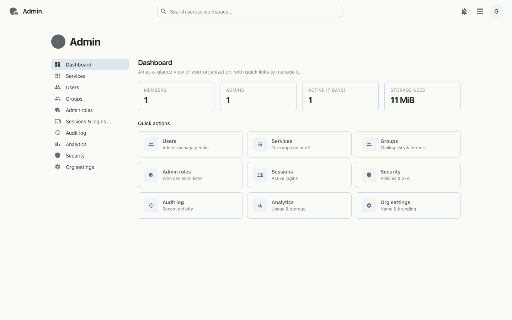

# Admin

Organization admin console — members, admins, services toggles, admin roles, audit log, analytics, security policies, and org settings. Shows live metrics (members, storage used).

## Desktop

---

_Live-captured at `http://workspace.localtest.me:8080/admin` against the local full stack, authenticated as `admin@adrient.localtest.me` via Zitadel SSO._

## Business apps, role presets and external users
- HR, Talent, Accounting, Inventory, POS, Invoicing and CRM are gated apps: they appear in App access, the effective-access preview and the App admin role picker.
- **Role presets** (App access, top card; `GET /api/v1/admin/app-access/presets`, `POST .../presets/{key}/apply {subject_type: group|user, subject_id}`): HR manager, Recruiter, Accountant, Sales rep, Store manager, Cashier, Purchasing officer. Applying adds an Allow rule for the chosen group or person on the preset's business apps and assigns App admin where the preset says so. Once an app has an Allow rule only the people it names can open it, so apply the preset to every group that needs the app. The reply lists the apps that became restricted.
- **External users (contractors)** can never open the seven business apps unless an Allow rule names them, their group, department or role; an "Everyone" rule does not count. Guests only see the apps on their invitation. Covered by `TestExternalUsersAreShutOutOfBusinessApps`.

## Security operations (identity and access)
Admin > **Security operations** adds sign-in risk alerts with a triage queue, a per-person Security panel (password, second step, sessions, tokens, account actions), allow/block lists, delegation roles (help desk, security analyst, identity admin, auditor), two-person approval, step-up re-authentication, reports with CSV export and an action log. Each person has a **My security** page at `/security` with their sessions, sign-in history, second steps and a "This wasn't me" button. See [iam-operations.md](../iam-operations.md) for the runbook and limits.

## Large organisations (10,000+ people)
Nothing in the console loads a full list. Pickers and tables follow the contract in `docs/design.md` ("Pickers and tables at scale").
- **Directory search**: `GET /api/v1/directory/search?q=&type=user|group|unit&limit=&cursor=`. At most 50 rows per page, keyset cursor, org scoped; name, email, employee ID, UPN and department are searched. The older `GET /api/v1/directory` keeps working and stays capped at 50.
- **People** (Admin > People): `GET /api/v1/people/page?q=&department=&sort=name|title|department|employee_id|email&order=&page=&limit=` plus `&format=csv` for a streamed export. The manager and department-head fields use the async person picker.
- **Users** (Admin > Users): `GET /api/v1/admin/users?limit=&cursor=&q=` returns `{users, items, next_cursor}`, ordered by name; each page asks the identity provider for only that page's ids.
- **Audit log**: `GET /api/v1/admin/audit` takes `actor_id`, `service`, `action`, `status`, `resource_id`, `from`, `to` (or `at` to jump to a date), `limit` (max 500, default 100) and `cursor`. The cursor is `(created_at, id)`, so events with the same timestamp are neither repeated nor skipped. The first page also returns `total_estimate` (capped at 10,000 with `total_capped`). `format=csv` streams every match (up to 1,000,000 rows). The screen offers a live refresh every 5 seconds.
- **Access pickers** (App access, Controls, Effective access, Admin roles, Offboarding, Role assignments) use the same async picker through `SubjectPicker`.
- **Indexes**: migrations 0365 (people, groups, units, audit, sign-in events, accounting; trigram indexes when `pg_trgm` can be created) and 0366 (audit service+action and service+status).
- **Scale test data**: `scripts/scale/seed_scale.sql` fills a scratch database with 20,000 people, 2,000 groups, 500,000 audit rows, 300,000 sign-in events, 100,000 journals and 100,000 CRM deals. It refuses to run against the shared `adrient` or `zitadel` databases. `scripts/scale/probe.py` times API calls against it.

### Second scale round
- Person fields across apps use `PersonSelect` / `PeopleSelect` (`web/app/src/components/PeoplePicker.tsx`), which search `/api/v1/directory/search` on the server. HR fields that store HR employee ids use `EmployeePicker` / `EmployeeMultiPicker` (`web/app/src/pages/hr/EmployeePicker.tsx`), which search `/api/v1/hr/employees`.
- The old `/api/v1/directory` callers (chat mentions, contacts, tasks, tickets, share dialogs, sheets protection, slides mentions, command palette) now call the paged search and get at most 50 rows.
- List caps: HR employees, invoices, journals and bank lines default to 100 rows per page (`limit`, `page` or `cursor`, max 200 to 500). Org people lists used by Legal and Talent are capped at 100, Chat people at 200, project and group member lists at 100. CRM only sends the people its records refer to (at most 300).
- Feeds with "Load older": honeypot alerts, rate-limit blocks, SCIM request log (keyset cursor).
- Picker rows show initials, not avatar images: one avatar request per row tripped the scan-burst tripwire.

## Console layout (wave 9)
- **Grouped navigation**: Overview, People, Access, Security, Apps, Data and logs, Organisation. The group of each page is defined in `web/app/src/pages/admin/AdminNav.tsx` (`NAV_GROUPS`); a page that is not listed lands under "More", so new pages appear without extra work.
- **Find a setting**: the box above the navigation searches page names, their one-line descriptions and keywords (for example "country" finds Region access, "dns" finds Domains). Every word must match. Covered by `AdminNav.test.ts`.
- **Page header**: breadcrumb (Admin / group / page), title and one line of help, from `SECTION_INFO` in the same file.
- On phones the navigation opens in the drawer with the same search.
- Not part of this change: sticky save bars with an unsaved-changes guard, user and group side panels and per-table bulk actions. Each page keeps its existing save buttons and dialogs.
>>>>>>> wave9/desk
