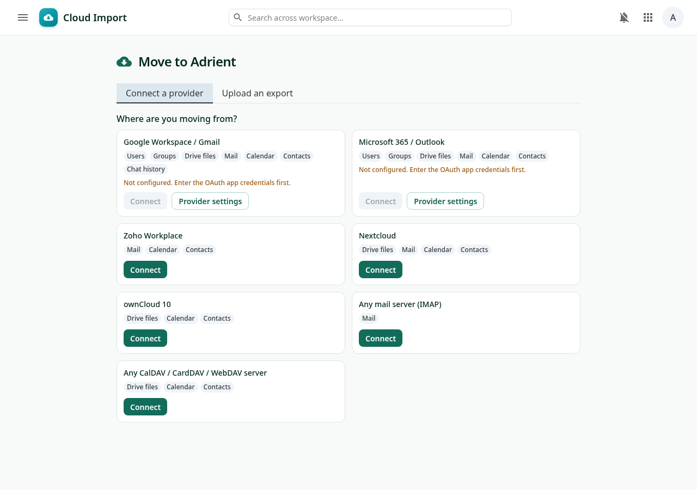
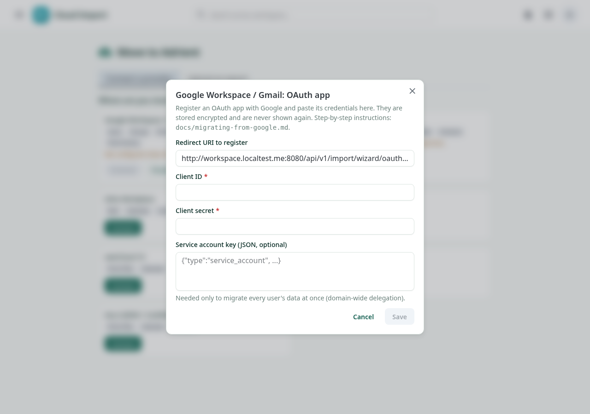
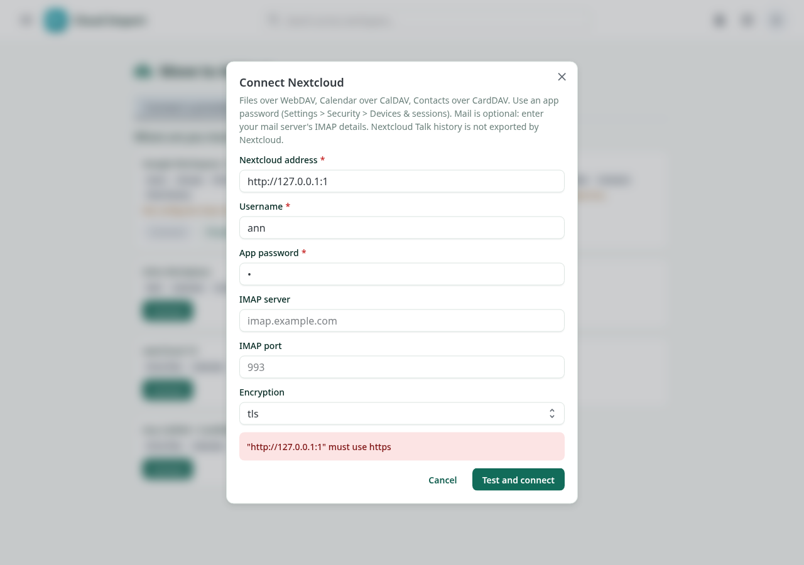

# Move to Adrient (Cloud Import and migration wizard)

Route `/cloudimport`. Two ways to bring data in:

- **Connect a provider**: a live, resumable migration from Google Workspace,
  Microsoft 365, Zoho, Nextcloud, ownCloud, any IMAP server or any
  CalDAV/CardDAV/WebDAV server.
- **Upload an export**: a Google Takeout `.zip`/`.tgz`, or single `.vcf`,
  `.ics` and `.mbox` files.

_Live-captured from the /migrate build on the local stack, signed in as
the dev admin._

## Providers

| Provider | Sign-in | Users / groups | Files | Mail | Calendar | Contacts | Chat |
|---|---|---|---|---|---|---|---|
| Google Workspace / Gmail | OAuth (admin enters app); org-wide needs a service account | yes (admin) | My Drive + shared drives, sharing, Docs exported to Office | IMAP + XOAUTH2, labels | yes | yes | Google Chat, own spaces |
| Microsoft 365 / Outlook | OAuth delegated, or app-only for org scope | yes | OneDrive + SharePoint, sharing | Graph, folders + categories | yes | yes | not available (protected API) |
| Zoho Workplace | app password | no | export ZIP and upload | IMAP | CalDAV | CardDAV | not available |
| Nextcloud | app password | no | WebDAV | optional IMAP | CalDAV | CardDAV | not available |
| ownCloud 10 | app password | no | WebDAV | no | CalDAV | CardDAV | no |
| Any IMAP | password | no | no | yes | no | no | no |
| Any CalDAV/CardDAV/WebDAV | password | no | WebDAV | no | CalDAV | CardDAV | no |

Per-vendor guides: [Google](../migrating-from-google.md),
[Microsoft](../migrating-from-microsoft.md),
[Zoho, Nextcloud, ownCloud, IMAP, DAV](../migrating-from-zoho.md).

## How a run works

1. An admin enters OAuth app credentials (Google, Microsoft) under
   **Provider settings**. They are sealed with AES-256-GCM
   (`ADRIENT_SECRETS_KEY`, falling back to the OIDC client secret) and never
   returned to the browser. Until then the provider says **Not configured** and
   cannot be connected.
2. A user (scope "my own account") or an admin (scope "whole organisation")
   creates a connection. Password providers are tested (IMAP login, DAV
   PROPFIND) before anything is saved. OAuth providers redirect to the vendor;
   the callback checks a one-time state bound to the connection and user.
3. Organisation scope: **Find users** lists the source directory and matches
   each account to an Adrient user by e-mail. The mapping table lets an admin
   map by hand or skip. Unmapped users are skipped and reported.
4. **Dry run** reads everything and counts it without writing.
5. A real run writes into Drive (under `Imported from <provider>`), Mail,
   Calendar, Contacts, Groups and Chat through their repositories.

**Idempotent and resumable.** Every imported item is recorded in
`import_map` (connection, kind, remote id → local id). A re-run skips mapped
items, so cancelling, a failure or a server restart (runs are then marked
*interrupted*) just means "start again". Mail is also de-duplicated by
Message-ID, which merges Gmail's one-message-many-labels into one message with
all labels.

**Rate limits.** Vendor calls retry 429/502/503/504 with exponential back-off
and jitter, honouring `Retry-After`, up to 6 attempts.

**Error report.** Each failed item is stored in `import_errors` and shown per
run; `GET .../runs/{id}/errors?format=csv` downloads it (values are
formula-escaped for spreadsheets).

**Safety.** All tables are org-scoped; a connection is visible to its creator,
and organisation connections to admins. Server URLs resolving to private,
loopback or link-local addresses, and plain `http://`, are refused unless
`ADRIENT_IMPORT_ALLOW_PRIVATE_HOSTS=1`. IMAP without TLS is only allowed to
loopback. Source mailboxes are opened read-only. Settings changes, connections
and runs are written to the audit log.

## API

All under `/api/v1/import/wizard/` (session required):
`GET providers`, `GET|PUT settings/{provider}` (admin),
`GET|POST connections`, `GET|DELETE connections/{id}`,
`POST connections/{id}/oauth/start`, `GET oauth/callback`,
`POST connections/{id}/discover`, `GET connections/{id}/users`,
`PUT connections/{id}/users/{remote}`, `GET|POST connections/{id}/runs`,
`GET runs/{id}`, `POST runs/{id}/cancel`, `GET runs/{id}/errors[?format=csv]`.
The archive importer keeps `POST /api/v1/import/upload` and
`GET /api/v1/import/jobs[/{id}]`.

Tables: migration `0220_import_wizard.sql` (`import_provider_settings`,
`import_connections`, `import_runs`, `import_user_map`, `import_map`,
`import_errors`), plus `0078` for archive jobs.

## Tests

- `internal/cloudimport/google_test.go`, `microsoft_test.go`, `dav_test.go`:
  each source against a local fake server (Google APIs + an IMAP server that
  speaks XOAUTH2; Microsoft Graph; a sabre/dav-style Nextcloud), dry run,
  real run, idempotent re-run, resume after cancel, 429 retry.
- `wizard_integration_test.go`: the HTTP API with Postgres and the real
  repositories: admin settings (secret sealed, never returned), OAuth code
  flow against a fake token endpoint, cross-user callback refused, dry run
  writes nothing, real run row counts, re-run adds nothing, CSV report.
- `web/app/src/pages/cloudimport/MigrationWizard.test.tsx`: UI states.
