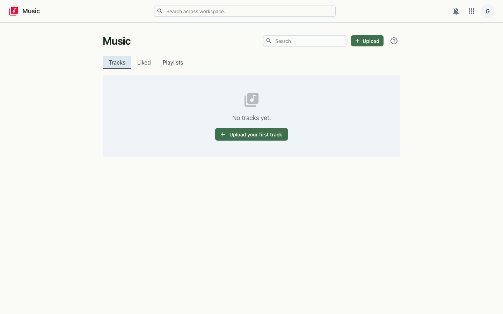
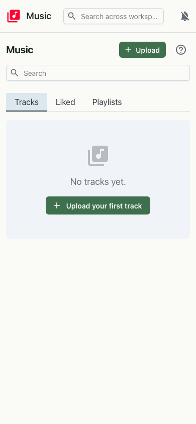

# Music

Music library and player — albums, playlists, and streaming radio.

## Desktop

## Mobile

---

_Live-captured at `http://workspace.localtest.me:8080/music` against the local full stack, authenticated as `admin@adrient.localtest.me` via Zitadel SSO._

## Redesigned app (wave 8)

Layout: left rail (Home, Explore, Library, Playlists, Upload, Radio), search with Songs/Albums/Artists/Playlists chips, a persistent bottom player, a queue drawer (drag to reorder) and a full-page Now playing view with synced lyrics.

- **Tags and cover art** are read from the file's ID3v2 header on upload and on Drive import (`internal/music/tags.go`). Other formats keep the typed title/artist.
- **Lyrics**: a `.lrc` file picked together with a song (same base name), or in the same Drive folder as an imported song, becomes the track's lyrics. Plain text works too. The owner can also paste lyrics in Now playing.
- **History and smart playlists**: a play is logged after 30 s (or half of a short song). Smart lists: most played, recently played, recently added, liked.
- **Playlists** are `private`, `org` or `group`. Playlists that existed before stay `org`. Only the owner changes sharing and order.
- **Drive**: "Add to library" points the track at the Drive blob (no copy). Deleting the track never deletes the Drive file.
- **Shortcuts**: Space/K play, Left/Right seek 5 s, Shift+Left/Right previous/next, Up/Down volume, M mute, S shuffle, R repeat, L like, Q queue, N now playing, `<` `>` speed, `/` search. Lock-screen controls use the Media Session API; the next song is preloaded.
- **API** (`/api/v1/music/x/`): `library`, `smart/{kind}`, `plays`, `history`, `tracks/{id}/lyrics`, `tracks/{id}/rescan`, `art/{id}`, `playlists`, `playlists/{id}` (GET, PATCH sharing), `playlists/{id}/order`, `groups`, `drive-files`, `import-drive`. Migration `0360_music_extras.sql`.
- **Assistant** tools: `music_find`, `music_queue`, `music_create_playlist` (asks first), `music_now_playing`.
- Not built: casting (by design), gapless playback (the next song is preloaded, a short gap can remain).
