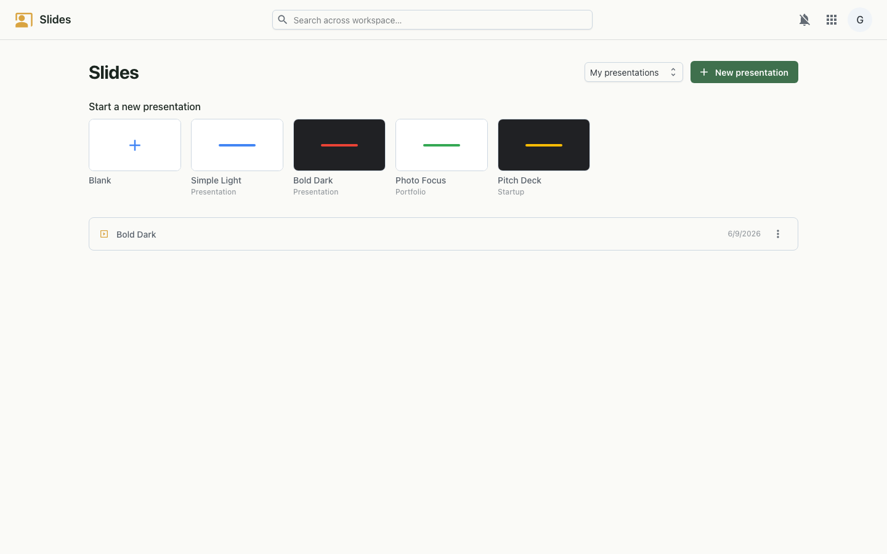
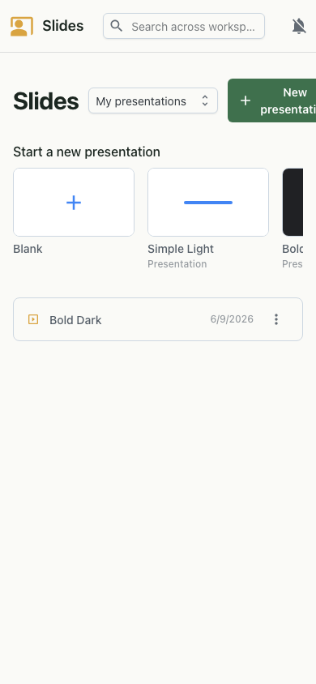

# Slides

Collaborative presentation editor and deck library.

## Desktop

## Mobile

---

_Live-captured at `http://workspace.localtest.me:8080/slides` against the local full stack, authenticated as `admin@adrient.localtest.me` via Zitadel SSO._

## PowerPoint-style editor

- **Ribbon** (default on desktop, `RibbonParts.tsx`, `RibbonPanels.tsx`): Home, Insert, Draw, Design,
  Transitions, Animations, Slide Show, Review, View. "Simple toolbar" switches back to the old toolbar
  (remembered in localStorage); phones always get the simple toolbar. The menu row (File, Edit, View,
  Insert, Format, Slide, Arrange, Tools, Help) stays; its never-built placeholder items were removed.
- **AutoSave** switch in the title bar. Off: changes wait for Save / Ctrl+S, the tab warns before closing
  with unsaved changes. A status reads Saving…, Unsaved, Saved or Save failed.
- **Slide master** (`MasterEditor.tsx`, `masterOps.ts`): edit every layout on the normal canvas, insert
  placeholders (title, subtitle, text, picture, date, footer, slide number), shapes and text, background,
  rename, duplicate, reorder, add and delete layouts (deleting unlinks the slides that used it).
- **Sections**, **slide sorter**, **rehearse timings**, **kiosk** (loops, ignores clicks, advances by timing,
  6 s default), **icons**, **matrix diagram**, **dark/light** toggle (follows the app colour scheme).
- **Insert from Adrient**: CRM, Inventory, POS, Invoicing (existing), plus a Sheets range as a table or
  chart, and a Docs page as text. These are snapshots taken at insert time with a link back to the
  source (clicking in the show opens it). They are not live-updating.
- **AI assistant slot**: the right panel lazy-loads `web/app/src/lib/ai/AssistantPanel.tsx` when that file
  exists and shows nothing otherwise; the View tab button only appears when it exists.

### PPTX fidelity (measured by `pptx/fidelity.test.ts`, `pptx/roundtrip.test.ts`, browser run)

Survives export then import: slide layouts with their placeholders and backgrounds, theme colours and
fonts, transitions with direction and duration, auto-advance timings, entrance/emphasis/exit effects on
shapes and on groups (diagrams), sections, notes, hidden slides, tables, charts, groups, comments.
Lost or simplified: motion paths and triggers (not supported), morph is written as a fade for PowerPoint,
WordArt and Adrient-specific object links are written as plain shapes/text. "File ▸ Import slides" adds
slides to the open deck only (layouts are matched by id; deck sections are not merged); opening a .pptx
from the deck list creates a full deck.

No database migrations: everything is stored in the deck JSON, which old decks load unchanged.

## motion paths, diagram layouts, responsive ribbon

- **Motion paths**: a fourth animation class, "Motion path", with Line, Arc, Circle and Zigzag. Each path has a
  direction and distance (circle: diameter) in the animation pane; open paths leave the shape at the end point
  and later paths start from there. pptx export writes `p:animMotion` with a path in slide fractions; import reads
  `presetClass="path"` back into the nearest of the four kinds (freeform paths are approximated by their end point).
- **Not built**: animation triggers (play on click of a shape). The importer still warns when a deck has them.
- **Diagram layouts**: Timeline, Funnel and Target join List, Process, Cycle, Hierarchy, Pyramid, Venn and Matrix.
- **Ribbon**: uses the shared responsive ribbon; buttons that are small by design keep their labels.
