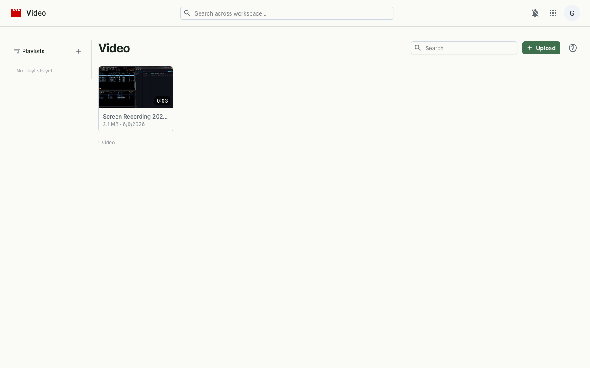

# Video

A YouTube-style video product — upload, browse, and watch videos hosted in the workspace.

## Desktop

---

_Live-captured at `http://workspace.localtest.me:8080/video` against the local full stack, authenticated as `admin@adrient.localtest.me` via Zitadel SSO._

## Redesigned app (wave 8)

Layout: left rail (Home, Subscriptions, Meetings, History, Watch later, Playlists, Your videos), search with date/duration/sort filters, a watch page with a custom player and an up-next column.

- **Player**: play, seek with a hover preview frame, chapter markers, speed, captions (`.vtt`), theatre mode, picture-in-picture, fullscreen, resume where you left off. Keys: Space/K, J/L ±10 s, Left/Right ±5 s, F, T, M, C, I, 0-9, `<` `>`, `,` `.`, Shift+N / Shift+P chapters.
- **Chapters**: lines like `0:00 Intro` in the description (first at 0:00, rising) become chapters; timestamps in the description and comments are clickable.
- **Comments** have replies (one level), likes and delete (author or video owner). **Subscriptions** follow a person's channel. **Watch later** and **history** are per user.
- **Visibility**: private, organisation or group. Existing videos stay organisation-visible. Streaming, the gRPC list and detail all enforce it.
- **Upload**: title, description, thumbnail from four frames or your own image, captions, visibility. The server fills in the duration and poster with ffmpeg/ffprobe when they are installed (state "processing" meanwhile). Without ffmpeg the browser's values are used.
- **Drive and Meet**: Drive videos are added by reference (a same-name `.vtt` in the folder becomes captions; deleting never removes the Drive file). Saved Meet recordings show in the Meetings shelf and open as private videos.
- **Owner numbers**: views, unique viewers, watch time, likes, comments and a 14-day chart in Your videos.
- **API** (`/api/v1/videos/x/`): `feed`, `videos/{id}` (GET, PATCH), `related`, `view`, `duration`, `stats`, `like`, `comments`, `comments/{id}/like`, `channels/{id}`, `subscriptions`, `watch-later`, `history`, `meetings`, `drive-files`, `import-drive`, `groups`, `poster/{id}`. Migration `0361_video_extras.sql`.
- **Assistant** tools: `video_find`, `video_captions` (for summaries), `video_watch_later`, `video_create_playlist`.
- Not built: multiple quality renditions (the quality menu is hidden), server-made seek sprites (the preview frame is drawn in the browser).
